# Unidad 2 – Integración de elementos en una red <!-- omit from toc -->

**Módulo:** Planificación y Administración de Redes

**RA2:** Integra ordenadores y periféricos en redes cableadas e inalámbricas, evaluando su
funcionamiento y prestaciones.

---


## 1. Medios físicos y estándares para redes cableadas e inalámbricas

*(CE-a: Se han identificado los estándares para redes cableadas e inalámbricas.)*

### 1.1 Definición y función

**El medio físico** es el soporte material o el canal por el que viajan las señales que transportan la información: pares de cobre, fibra óptica o el espacio libre para enlaces inalámbricos. Su selección condiciona la velocidad, la distancia máxima, la fiabilidad y el coste de una red.

### 1.2 Estándares relevantes

- **IEEE 802.3 (Ethernet):** define capas físicas y de enlace para Ethernet en distintas velocidades (10/100/1000/10G...).
- **IEEE 802.11 (Wi‑Fi):** familia de estándares para LAN inalámbrica (802.11a/b/g/n/ac/ax), con bandas 2.4 GHz y 5/6 GHz y diferentes modulaciónes.
- **IEEE 802.15 (Bluetooth y WPAN):** comunicaciones de corto alcance.
- **ITU‑T y TIA/EIA:** recomendaciones para fibra y cableado estructurado (p. ej. TIA/EIA‑568 para UTP).

### 1.3 Factores físicos que afectan la transmisión

En una transmisión de información puede haber problemas producidos por cualquiera de las partes que intervienen (emisor, receptor, canal, información..).

Los problemas más difíciles de solucionar son los relacionados con la naturaleza de la señal a transmitir y del medio empleado, generalmente problemas de `tipo electromagnético`.

Las **perturbaciones** en la transmisión de una señal eléctrica consisten en pérdidas de información ocurridas en el transporte de la señal desde el emisor hasta el receptor. Estas perturbaciones son inevitables, pues existen una serie de factores que afectan a la calidad de las señales transmitidas los cuales provocan que estas nunca sean iguales a las señales recibidas.

El **efecto de las perturbaciones** varía según la naturaleza analógica o digital de las señales. Mientras en las `señales digitales` se reduce la velocidad de transmisión al aumentar la tasa de errores de bits, el efecto en una `señal analógica` consiste en que esta línea de transmisión introduce variaciones de amplitud y frecuencia, lo que degrada la calidad de la señal.

Las principales perturbaciones son:

- **Atenuación:** Es la pérdida de amplitud de la señal. El medio por el que viajan las señales puede ofrecer cierta resistencia, que hace que las señales pierdan algo de energía. Para recuperar la amplitud original se usan repetidores en señales digitales o amplificadores en señales analógicas. Depende de la distancia y la frecuencia. Es la pérdida de potencia con la distancia (más crítica en cobre que en fibra).

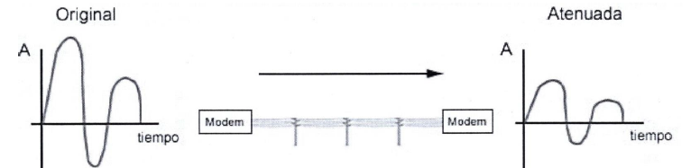

- **Distorsión:**
Es un cambio de forma en la señal. Cuando una señal es compuesta, como las digitales, cada componente tiene su propia velocidad de propagación y puede alcanzar el destino en diferentes instantes de tiempo. Las componentes más lentas sufren un desfase. Esto puede hacer que la lectura de la señal por el receptor sea distinta.
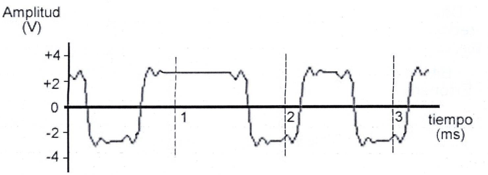

- **Ruido:**
  Es la aparición de nuevas señales que no pertenecen a la transmisión. Puede ser:

    - **Ruido térmico:** se debe a la agitación térmica de los electrones que forman el propio cable. Es inevitable.
    - **Diafonía (crosstalk):** cuando dos cables están próximos y las señales de uno son recibidas por el otro. Se denomina también acoplo entre pares; mitigado con trenzado y apantallamiento.
    - **Ruido impulsivo:** consiste en pulsos aleatorios de bastante amplitud y corta duración. Ocurren al encender o apagar ciertos dispositivos.
    - **Ruido inducido:** perturbación causada por interferencias electromagnéticas externas que inducen señales no deseadas en el cable, por ejemplo, las generadas por motores o electrodomésticos.
<div align="center">
	
</div>

- **Interferencias electromagnéticas (EMI):** fuentes externas que afectan señales eléctricas.
- **Relación señal‑ruido (SNR):** determina la calidad y la capacidad del enlace.
- **Ancho de banda teórico vs. tasa efectiva:** overhead de protocolos y retransmisiones reducen rendimiento real.
    - **Ancho de banda:** Define la capacidad máxima disponible para transmitir bits. Se puede definir como la diferencia entre la frecuencia máxima y mínima de las señales que se pueden transmitir por un canal. Se suele expresar en hercios (Hz) o sus múltiplos (KHz, MHz…).
    - **Tasa de transferencia o velocidad de transmisión:** Son los bits (de datos y de control) por segundo que se transmiten. Permite cuantificar la velocidad a la que pueden transmitirse los datos por un canal. Se mide en bits por segundo (bps) o sus múltiplos (kbps, Mbps…).
    - **La tasa de transferencia efectiva:** son los bits de datos transferidos por segundo (sin los bits de control).

La tasa de transferencia nunca es mayor que el ancho de banda. Esto se debe a las limitaciones impuestas por los medios de transmisión, medios de interconexión, topologías y todos los dispositivos y aplicaciones que operan en la red.

### 1.4 Selección práctica del medio (criterios)

- Cortas distancias y bajo coste → UTP (Cat5e/Cat6).
- Enlaces troncales o largas distancias → fibra monomodo.
- Entornos con mucho ruido eléctrico → fibra óptica.
- Movilidad o dispositivos móviles → soluciones Wi‑Fi con planificación de canales.

**Ejemplo de estructura**
Para un aula de 25 puestos con servidor local: UTP Cat6 para los puestos (1 Gbps) y fibra multimodo OM3 entre armarios de comunicaciones para permitir 10 Gbps entre switches si se prevé crecimiento.

---


## 2. Cables metálicos: tipos, construcción y uso

*(CE-a, CE-j, CE-k: identificación y clasificación de cables metálicos y ópticos según velocidad y distancia.)*
### 2.1 Coaxial y par trenzado: estructura y propiedades

- **Coaxial:** conductor central (señal), dieléctrico, malla (blindaje) y cubierta. Uso actual reducido en LAN, aún empleado en TV y redes HFC(híbridas de fibra y coaxial) combinan ambos medios:
    - La `fibra optica` lleva la señal desde la central del operador hasta un nodo cercano a los usuarios
    - Desde ese nodo, el `cable coaxial` distribuye la señal a las viviendas o locales.
    - Se usan habitualmente en redes de televisión por cable y para ofrecer acceso a Internet. La fibra permite cubrir largas distancias con poca pérdida, y el coaxial aprovecha el cableado ya instalado en la zona
- **Par trenzado (UTP/STP):** pares de conductores trenzados para reducir interferencias; **STP/FTP** añaden apantallamiento para entornos ruidosos.

### 2.1.1 Cable coaxial: estructura y tipos

- Estructura básica (desde el interior hacia fuera):
    1. Conductor central o nucleo conductor (busca transportar la señal eléctrica, suele ser cobre sólido o trenzado).
    2. Dieléctrico (es el material aislante) que separa el conductor del blindaje. Evita el contacto eléctrico entre conductor y blindaje y controla las propiedades eléctricas del conjunto
    3. Blindaje (malla metálica y/o lámina) que protege frente a interferencias electromagnéticas(EMI) y reduce la radiación de la señal.
    4. Cubierta exterior (jacket) que protege mecánicamente el conjunto.
<div align="center">
	
</div>

 - **Tipos comunes:** RG‑6 (TV, satélite), RG‑59 (vídeo analógico, corto alcance), RG‑11 (menor atenuación, distancias mayores).
 - **Conectores habituales:** BNC (vídeo profesional), F‑type (TV/SAT, roscado) y N/SC para aplicaciones de mayor potencia o RF.

### 2.1.2 Par trenzado: estructura, apantallamientos y clasificación

- **Estructura básica:** varios pares de conductores trenzados dentro de una cubierta; el trenzado reduce diafonía y mejora inmunidad al ruido.
- Es el medio guiado más barato y más usado.
- Es actualmente el tipo de cable más común en redes de área local.
- Cada cable de este tipo está compuesto por una serie de pares de cables trenzados. Los pares se trenzan de forma helicoidal para reducir la diafonía o interferencia entre pares adyacentes.
- El cable típico en las redes de área local y en la conexión final de equipos es el de 4 pares. Los cables multipar pueden tener 25, 50, 100, 200 y 300 pares.
- Las normativas de cableado estructurado clasifican los diferentes tipos de cable de pares trenzados en categorías de acuerdo con sus características para la transmisión de datos, las cuales vienen fijadas fundamentalmente por la densidad de trenzado del cable (número de vueltas por metro) y los materiales utilizados en el recubrimiento aislante. 
<div align="center">
	
</div>

- **Tipos según apantallamiento:**
    - `UTP (Unshielded Twisted Pair):` par trenzado sin apantallamiento, más económico y flexible. Usado en redes Ethernet; no lleva lámina ni malla de protección (por eso "unshielded").
    - `STP (Shielded Twisted Pair):`Par trenzado con apantallamiento; cada par o el conjunto ica de pares lleva una lámina apantallado (foil/braid) para reducir EMI en entornos ruidosos.
    - `FTP (Foiled Twisted Pair):` par trenzado con una lámina metálica (foil) envolviendo todos los pares; capa global de lámina que envuelve los pares; mezcla de coste y protección.
    
    - **Distinción:** a diferencia de `STP`, `FTP` suele proteger el conjunto de pares con una lámina única (no necesariamente tiene malla por par).

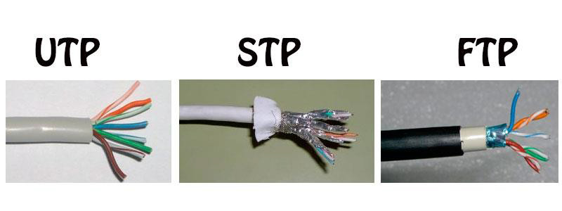


### 2.2 Categorías UTP y rendimiento 

| Categoría | Frecuencia aproximada | Velocidad típica | Uso típico |
|---|---:|---:|---|
| Cat5e | 100 MHz | 1 Gbps | Redes LAN 1 Gbps hasta 100 m |
| Cat6 | 250 MHz | 1 Gbps (hasta 100 m) / 10 Gbps (hasta ~55 m) | Redes gigabit, entornos actuales |
| Cat6a | 500 MHz | 10 Gbps (hasta 100 m) | Centros de datos, enlaces de alto rendimiento |
| Cat7 / Cat7a | 600–1000 MHz | 10 Gbps y superiores | Entornos con apantallamiento, cableado industrial |
| Cat8 | hasta 2000 MHz | 25–40 Gbps (corto alcance) | Backbones de rack, data centers (corto alcance) |

**Nota:** la velocidad real depende de transceptores, calidad de crimpado, ruido y longitud del enlace.

#### 2.2.1 Parámetros importantes: atenuación, NEXT (Near‑End Crosstalk), PSNEXT y pérdida de retorno.

- **Atenuación:** pérdida de potencia de la señal al propagarse por el medio; se expresa en dB por unidad de longitud (p. ej. dB/100 m). A mayor atenuación, menor amplitud de la señal en el receptor y más ruido relativo.

- **NEXT (Near‑End Crosstalk):** diafonía medida en el extremo cercano (near end) entre pares dentro del mismo cable; cuantifica la señal interferente que llega al receptor en el mismo extremo que transmite la señal interferente. Se mide en dB; mayor NEXT = mejor aislamiento.

- **PSNEXT (Power Sum NEXT):** suma de las diafonías (NEXT) de varios pares interferentes considerada como una potencia total; refleja el efecto conjunto de todas las parejas que interfieren sobre un par victimizado. Se usa para comprobar rendimiento cuando hay múltiples pares activos.

- **Pérdida de retorno (Return Loss):** medida de la energía reflejada por desadaptaciones de impedancia a lo largo del enlace; se expresa en dB (positivo). Alta pérdida de retorno (valores grandes en dB) significa pocas reflexiones y buena adaptación; baja pérdida de retorno indica reflexiones que degradan la señal.

Los instrumentos que miden estos parámetros:

- **Certificador/medidor de cable (p. ej. Fluke):** mide atenuación, NEXT y PSNEXT, pérdida de retorno, longitud y mapeo de pares; entrega reportes de conformidad por categoría.
- **Tester de pares / comprobador de continuidad:** comprueba continuidad, cortocircuitos e inversión (no suele medir NEXT ni pérdida de retorno).
<div align="center">
	
</div>

### 2.3 Conectores y normas de terminación (par trenzado)

- Conector estándar: RJ‑45 (8P8C). Normas de polarización: T568A y T568B.
- Selección según categoría: los conectores y jacks certificados para Cat6/Cat6a garantizan parámetros eléctricos mejores (NEXT, propagación, pérdida de retorno).

### 2.4 Reglas prácticas

- Evitar curvas con radio menor al recomendado por el fabricante (p. ej. 4× el diámetro del cable).
- No estirar excesivamente el cable al tenderlo; respetar distancia máxima de 100 m para enlaces UTP.
- Mantener separación respecto a fuentes EMI (cables eléctricos, motores) o usar STP/FTP si no es posible.
 

### 2.5 Conectores y estándares de terminación

- **RJ‑45** (8P8C) es el conector estándar para par trenzado; normas T568A y T568B definen el orden de los hilos.
- **BNC** es típico en coaxial; 
- **LC/SC/ST/FC** según equipo son típicos en fibra óptica.

### 2.6 Fibra óptica: monomodo vs multimodo

**Un sistema de transmisión por fibra óptica** consta principalmente de tres partes:
- **Elemento transmisor:** encargado de generar el haz luminoso. Ej.: led, láser…
- **Medio físico de transmisión:** responsable de guiar la luz desde el origen al destino. Es el cable de fibra óptica.
- **Elemento receptor:** Es el que recibe la señal y la transforma de forma adecuada para su procesamiento. Son fotodiodos o fotodetectores.

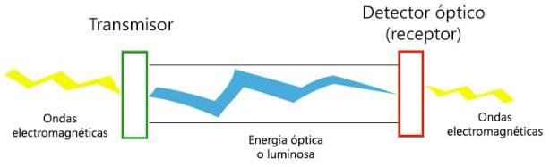

El **cable de fibra óptica** es el medio físico utilizado para transportar la luz, de forma que transmita información binaria. Principalmente, se compone de tres partes:
- **El núcleo:** está formado por una o varias fibras muy finas de cristal o plástico.
- **El revestimiento:** rodea al núcleo y permite la refracción de la luz. Está hecho de cristal o plástico de diferentes propiedades ópticas distintas a las del núcleo.
- **El recubrimiento o cubierta:** constituida de material plástico o similar. Se encarga de proteger al conjunto de golpes, abrasiones, humedades, etc.
<div align="center">
	
</div>

#### 2.6.1 Tipos de fibras ópticas:

- **Multimodo (MMF, OM1–OM5):** es aquella en la que los haces de luz pueden circular por más de un modo o camino. Esto supone que no llegan todos a la vez. Una fibra multimodo puede tener más de mil modos de propagación de luz. Se usa comúnmente en aplicaciones de corta distancia, menores a 2 km, como redes informáticas. Es simple de diseñar y económico lámparas/LEDs o láseres VCSEL; adecuadas para enlaces LAN y centros de datos (distancias cortas‑medias). 

- **Monomodo (SMF):** es una fibra óptica en la que solo se propaga un modo de luz. Se logra reduciendo el diámetro del núcleo de la fibra hasta un tamaño que solo permite un modo de propagación. Su transmisión es paralela al eje de la fibra. A diferencia de las fibras multimodo, las fibras monomodo permiten alcanzar grandes distancias (hasta 400 km) y transmitir elevadas tasas de información (10 Gbit/s). Se utilizan en televisión por cable, Internet y teléfono.núcleo fino, láser, usadas en enlaces de larga distancia y troncales.

**Ejemplo**
Comparación: para un enlace entre armarios a 500 m se elegirá fibra multimodo OM4/OM3 si el presupuesto lo permite para 10 Gbps; para enlaces >2 km usar monomodo.


### 2.6.2 Ventajas de la fibra óptica
1. Una banda de paso muy ancha, lo que permite velocidades muy elevadas (Gbps).
2. Pequeño tamaño, por lo tanto, ocupa poco espacio.
3. Gran ligereza, el peso es bajo, unas nueve veces menos que el de un cable convencional.
4. Inmunidad total a las perturbaciones de origen electromagnético, lo que implica una calidad de transmisión muy buena.
5. Gran seguridad: la intrusión en una fibra óptica es fácilmente detectable por el debilitamiento de la energía lumínica en recepción. Además, no irradia nada, lo que es interesante para aplicaciones que requieren alto nivel de confidencialidad.
6. No produce interferencias.
7. Insensibilidad a las señales parásitas, lo que permite utilizarla en medios industriales fuertemente perturbados (por ejemplo, en los túneles del metro). Ello permite la coexistencia por los mismos conductos con los cables de energía eléctrica.
8. Atenuación muy pequeña, lo que permite salvar grandes distancias sin elementos activos intermedios.
9. Gran resistencia mecánica, al calor, al frío y a la corrosión.
10. Facilidad para localizar los cortes, lo que permite detectar rápidamente el lugar donde se hará la reparación de la avería, simplificando la labor de mantenimiento.

---

## 3. Conexión inalámbrica

### 3.1 Según  el Medio físico: radiofrecuencia, microondas, infrarrojos

- **Ondas de radio (RF):** Las ondas de radio son fáciles de generar, pueden viajar a largas distancias, atraviesan edificios y viajan en todas las direcciones. Usada por Wi‑Fi (2.4/5/6 GHz). Buena penetración en interiores y usada para la mayoría de WLAN.
- **Microondas:** Las microondas, además de su aplicación en hornos microondas, permiten transmisiones tanto con antenas terrestres como con satélites. Frecuencias más altas para enlaces punto a punto (backhaul). Requieren línea de vista para largos enlaces y ofrecen alta capacidad.

  > Nota — "línea de vista" (LOS): significa que debe existir una trayectoria visual despejada entre las antenas emisora y receptora, sin obstáculos significativos en el eje principal. Además de la vista directa, es importante respetar la zona de Fresnel (un espacio elíptico alrededor del eje de la señal) para evitar pérdidas por difracción; en enlaces muy largos también hay que tener en cuenta la curvatura terrestre y por tanto elevar las antenas (torres/polos) para mantener la LOS y la zona de Fresnel despejada.

- **Infrarrojos (IR):** es un tipo de radiación de mayor longitud de onda que la luz visible. No atraviesan objetos sólidos.
comunicaciones ópticas de corto alcance y línea de vista; muy poco usadas en WLAN modernas. Se utilizan en comunicación de corto alcance, como en control remoto de electrodomésticos o el puerto de infrarrojos de ordenadores portátiles.
No es necesario obtener una licencia del gobierno para operar con sistemas de transmisión infrarrojos.

### 3.2 Tipos de conexión inalámbrica (modos de funcionamiento)

Un **AP** (*Access Point*, **punto de acceso**) es el dispositivo que permite que los equipos inalámbricos se conecten a una red. Recibe las tramas por Wi-Fi y las reenvía a la red cableada, y también hace el recorrido inverso. Por ejemplo, un portátil asociado al AP puede comunicarse con un servidor conectado al switch.

El AP **no es necesariamente un router**: su función principal es proporcionar acceso inalámbrico a una red existente. En los equipos domésticos es habitual que un mismo aparato integre varias funciones: router, switch, AP y, a veces, módem. En los diagramas de este apartado, `AP` significa únicamente **punto de acceso Wi-Fi**.

Importante para prácticas y diseño de red:

- **Modo infraestructura (BSS / ESS):** el más común. Los clientes se conectan a uno o varios puntos de acceso (AP); los APs pueden estar gestionados por un controlador o actuar como entidades independientes. En ESS (Extended Service Set) varios AP conectados forman una misma red con roaming.
- **Modo ad‑hoc (IBSS, peer‑to‑peer):** dispositivos se comunican directamente entre sí sin AP. Útil para conexiones puntuales o entornos sin infraestructura.
- **Modo mesh (802.11s u otras implementaciones):** nodos inalámbricos interconectados formando una malla que reenvía tráfico entre ellos; útil para desplegar redes inalámbricas distribuidas y resilientes.

Cada modo tiene implicaciones en seguridad, gestión (RADIUS/802.1X normalmente en infraestructura) y en la forma de medir/analizar la cobertura y el roaming.

#### 3.2.1 Diagramas: modos y topologías

En estos diagramas conviene separar dos ideas:

- **Modo de funcionamiento:** indica cómo se comunican los dispositivos: mediante un AP (infraestructura), directamente entre ellos (ad-hoc) o a través de varios nodos que reenvían tráfico (mesh).
- **Topología:** indica cómo se organizan y conectan esos dispositivos: una celda, varias celdas conectadas, una malla o un enlace punto a punto/punto a multipunto.

Una **celda inalámbrica** es el área de cobertura de radio de un AP. En una celda única hay un solo AP y todas las estaciones asociadas a él comparten el mismo BSS (*Basic Service Set*). Las estaciones no se conectan entre sí directamente: envían las tramas al AP, que las entrega a la estación destino o a la red cableada.

| Diagrama | Modo o topología | ¿Hay AP? | Comunicación principal | Uso habitual |
|---|---|---:|---|---|
| Celda única | Infraestructura, un BSS | Sí, uno | Estación ↔ AP | Aula, vivienda o pequeña oficina |
| ESS / roaming | Infraestructura, varios BSS | Sí, varios | Estación ↔ AP más cercano | Edificios con cobertura amplia |
| Ad-hoc / IBSS | Comunicación directa | No | Estación ↔ estación | Conexión temporal sin infraestructura |
| Mesh | Infraestructura distribuida | Nodos mesh | Nodo ↔ nodo; un nodo reenvía | Zonas donde no es práctico cablear todos los AP |
| PTP / PMP | Topología de radioenlace | Antenas de enlace | Sitio ↔ sitio o sitio ↔ varios sitios | Interconexión de edificios o backhaul |

**Cómo leer los diagramas:** `wifi` representa un enlace inalámbrico entre una estación y un AP o entre dos nodos; `cable` representa la red de distribución cableada; y `mesh` representa un enlace inalámbrico entre nodos que pueden reenviar tráfico. El círculo de cobertura de un AP no se dibuja a escala: solo sirve para identificar la celda.

**1. Celda única (un AP, un BSS)**

El bloque delimitado representa una única celda. El AP es el punto central de la comunicación y las estaciones son los dispositivos clientes.

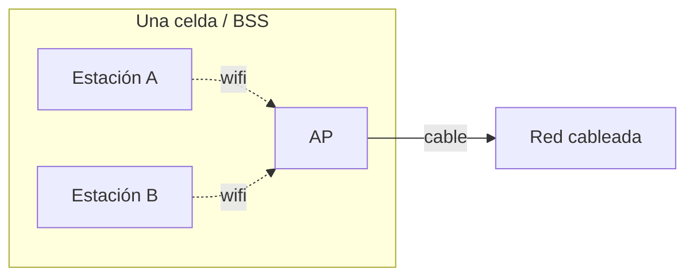

**2. ESS y roaming (varios BSS con el mismo SSID)**

Cada AP crea su propia celda o BSS. Al estar conectados a la misma red de distribución y anunciar normalmente el mismo SSID, una estación puede pasar de un AP a otro al desplazarse. El cambio de AP es el **roaming**; las celdas suelen solaparse para evitar zonas sin cobertura.

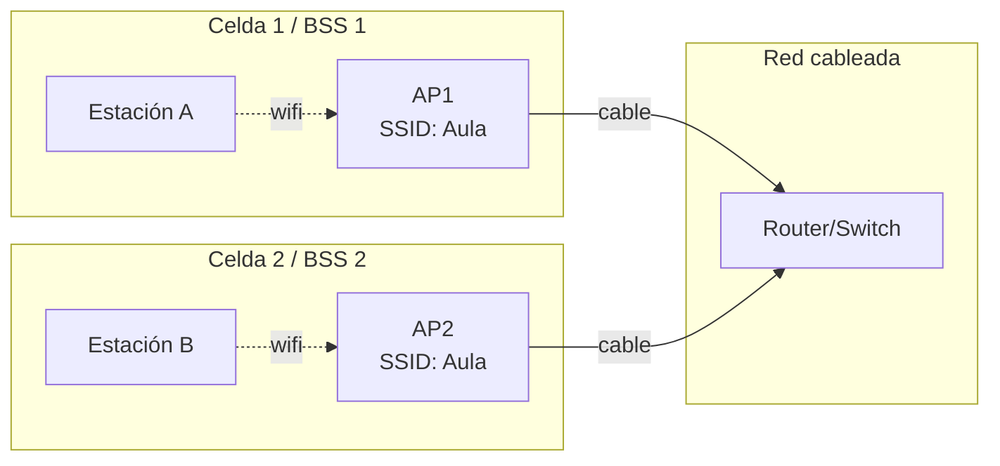

**3. Ad-hoc (IBSS, peer-to-peer)**

No existe AP ni red de distribución. Las estaciones forman un IBSS y se comunican directamente. Por eso no es una “celda con AP”: todos los dispositivos participan como iguales. Es apropiado para una conexión puntual, pero ofrece menos control y capacidad de gestión que el modo infraestructura.


**4. Mesh (malla inalámbrica)**

Los nodos mesh forman una red inalámbrica entre ellos. Un nodo puede actuar como punto de acceso para las estaciones y, al mismo tiempo, reenviar el tráfico hacia otro nodo hasta alcanzar la red cableada. La malla puede tener varios caminos; si falla un enlace, la red puede buscar otro recorrido, según la implementación.

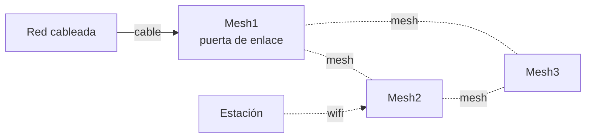

**5. Radioenlaces: PTP y PMP**

Estos enlaces describen una topología de interconexión o *backhaul*, no un modo de asociación de clientes Wi-Fi:

- **PTP (*Point-to-Point*):** una antena conecta directamente dos sedes.
- **PMP (*Point-to-Multipoint*):** una antena central conecta con varias sedes remotas.

En ambos casos suele ser necesaria la línea de vista (LOS). Las antenas transportan el tráfico entre redes; los equipos de cada sede proporcionan después el acceso local.

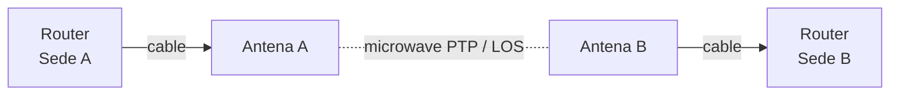

En un enlace PMP, una antena central da servicio a varias sedes:

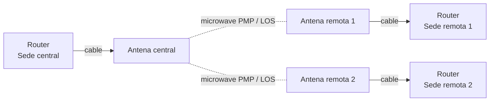

### 3.3 Tipos de autenticación y acceso en WLAN

Cómo pueden autenticarse y acceder los usuarios a una WLAN:

- **Acceso abierto (Open):** el SSID está visible y no se requiere clave para asociarse. Es práctico para redes públicas pero poco seguro.
- **Portal web / Captive portal:** tras la asociación, el usuario es redirigido a una página web para autenticarse o aceptar condiciones. Usado para invitados y redes públicas.
- **WPA/WPA2/WPA3 PSK:** autenticación mediante clave compartida (pre‑shared key). Adecuado para entornos domésticos o pequeños grupos.
- **WPA/WPA2/WPA3 Enterprise (802.1X + RADIUS):** autenticación individual mediante servidor RADIUS y EAP. Soporta métodos como EAP‑PEAP (usuario/contraseña) y EAP‑TLS (certificados), y permite aplicar políticas (VLAN, tiempo, etc.).

Buenas prácticas de seguridad:
- Evitar WEP y TKIP (obsoletos).
- Preferir WPA2‑Enterprise o WPA3 cuando sea posible.
- En captive portals usar HTTPS y, si procede, un túnel VPN para proteger credenciales.
- Asegurar el servidor RADIUS y usar shared secrets fuertes.

## 4. Direccionamiento  físico: Mac, ARP, dominios de broadcast y colisión 

*(CE-d: uso del direccionamiento lógico IP para asignar direcciones y máscaras.)*

Para poder identificar de forma única los diferentes dispositivos dentro de una red informática se utiliza un mecanismo de identificación llamado direccionamiento.
En una red de ordenadores hay dos tipos de direcciones: 
- direcciones físicas 
- direcciones lógicas

### 4.1 Conceptos básicos

- **Dirección IP:** identificador lógico de **una interfaz en una red** (IPv4/IPv6).
- **Máscara o prefijo:** determina la porción de red y la de host (p. ej. /24, /64).
- **Dirección de broadcast (IPv4):** dirección para enviar a todos los hosts de la subred.
- **Puerta de enlace (gateway):** router que conecta la subred con otras redes.
- **Tabla de enrutamiento:** conjunto de rutas que usan los routers/hosts para encaminar paquetes.

### 4.2 Direccionamiento físico: direcciones MAC y ámbito

- **Dirección MAC(Media Access Control):** identificador único de 48 bits (normalmente) asignado a la interfaz de red por el fabricante (formato hex `00:1A:2B:3C:4D:5E`).
- **Ámbito de actuación:** la dirección MAC opera en la capa de enlace (OSI capa 2) y se usa para la entrega de tramas en el mismo dominio de broadcast (misma LAN / VLAN). Estas direcciones son válidas unicamente en el ámbito local.
 - **ARP (Address Resolution Protocol):** protocolo de la capa de enlace que resuelve una dirección IPv4 a una dirección MAC dentro de la misma subred mediante solicitudes y respuestas (ARP request/ARP reply).
	 - `¿Qué es ARP?:` ARP es el mecanismo por el que un host descubre la dirección MAC asociada a una dirección IPv4 cuando necesita enviar una trama dentro de la misma LAN. Funciona enviando una petición broadcast y recibiendo una respuesta unicast con la dirección MAC.
 - **Estructura de una MAC:** las direcciones MAC suelen tener 48 bits (6 octetos). Los 3 primeros octetos forman el OUI (Organizationally Unique Identifier) que identifica al fabricante; los 3 octetos finales son asignados por el fabricante para cada interfaz.
	 - Ejemplo: `00:1A:2B:3C:4D:5E` → OUI `00:1A:2B` (fabricante), sufijo `3C:4D:5E` (identificador de interfaz).
 - **Unicidad y casos de duplicado:** en teoría cada MAC debe ser única. Los fabricantes registran OUIs y generan sufijos para evitar colisiones.
	 - *Casos que provocan duplicados:* clonación manual (configuración intencionada), máquinas virtuales que duplican MAC por snapshot/import, dispositivos defectuosos o fabricantes que no respetan el asignamiento, o reutilización en redes virtuales.
	 - *Efectos de duplicado:* conflictos de enlace (tramas alternando entre puertos), problemas de ARP, pérdida de conectividad para una o ambas interfaces.
	 - *Mitigación:* asignar MACs estáticas válidas en elementos críticos, usar seguridad en switches (port security), gestionar MACs en entornos virtuales y evitar clonar sin control.

### 4.3 Dominios de colisión y de difusión(broadcast)

- **Un dominio de colisión** es el segmento donde dos transmisiones simultáneas pueden interferir. Los switches separan los dominios por puerto; en una red conmutada y full-duplex normalmente no hay colisiones. Las colisiones se producián en redes Ehternet antiguas con `hubs` donde varios equipos compartían el mismo medio y podían transmitir a la vez. También podía ocurrir en `Ehternet half-duplex`.

- **Un dominio de difusión** es el conjunto de dispositivos que reciben una trama broadcast de capa 2. Una VLAN delimita uno; para comunicar dominios distintos hace falta un router o un dispositivo de capa 3.

A partir de las capas del modelo OSI es posible determinar qué dispositivos extienden o componen los dominios de colisión y difusión. 
1. Dispositivos de la capa 1 OSI (concentradores y repetidores) reenvían todos los datos transmitidos en el medio, por lo tanto, extienden los dominios de colisión. 
2. Dispositivos de la capa 2 y 3 OSI (conmutadores o swiches) segmentan los dominios de colisión. 
3. Dispositivos de la capa 3 OSI (routers) segmentan los dominios de colisión y difusión (broadcast). 

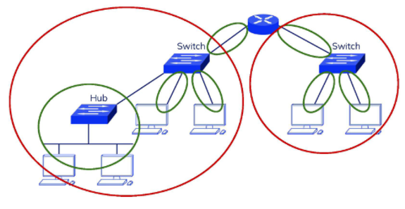

### 4.4 Comandos útiles para comprobar MAC/ARP

- Windows:
    - Ver ARP: `arp -a` (muestra asociaciones IP → MAC en caché).
    - Ver adaptadores y MACs locales: `getmac /v` o `wmic nic where (MACAddress is not null) get MACAddress,Name`.
    - Forzar renovación DHCP y comprobar: `ipconfig /release` y `ipconfig /renew`.
- Linux:
    - Ver vecinos/ARP: `ip neigh` o `arp -n`.
    - Ver interfaces y MAC locales: `ip link show` o `cat /sys/class/net/<iface>/address`.
    - Ver tabla de direcciones MAC del switch (si tiene acceso SSH/CLI): `show mac address-table` (Cisco) o comandos equivalentes según fabricante.

**Ejemplo Linux:**
```
$ ip link show eth0
2: eth0: <BROADCAST,MULTICAST,UP,LOWER_UP> mtu 1500 qdisc fq_codel state UP mode DEFAULT group default qlen 1000
		link/ether 00:1a:2b:3c:4d:5e brd ff:ff:ff:ff:ff:ff
```

**Ejemplo Windows PowerShell:**
```shell
PS> Get-NetAdapter | Format-Table -Auto Name,MacAddress,Status
```
- *Switches:* dispositivos que reenvían tramas usando tablas MAC (CAM) aprendidas por puerto; las direcciones MAC permiten conmutación local sin intervención de routers.
- *Diferencia con IP:* la MAC identifica la interfaz física; la IP identifica la interfaz lógica sobre la red y permite enrutamiento entre subredes.

**Ejemplo:** cuando un host A (192.168.1.10) envía un paquete a 192.168.1.20 en la misma VLAN, encapsula el paquete IPv4 dentro de una trama con la MAC destino correspondiente; si no la conoce, envía una ARP request y recibe la MAC en la ARP reply.

## 5 Direccionamiento lógico (IPv4/IPv6)

Una **dirección lógica** identifica de forma única una interfaz de red o tarjeta de red, en un ámbito local o global, es decir, es utilizada por los dispositivos para comunicarse con otros dispositivos de la misma red local o fuera de ella.

La dirección IP puede cambiar, debido a los cambios de red o por un cambio en la asignación automática (protocolo DHCP). A esta forma de asignación de dirección IP se le denomina también dirección **IP dinámica**.

Los sitios de Internet que por su naturaleza necesitan estar permanentemente conectados, generalmente tienen la necesidad de una dirección IP fija (comúnmente, **IP fija o IP estática**). 
Esta no cambia con el tiempo. Los servidores de correo, DNS, FTP públicos y servidores de páginas web necesariamente deben contar con una dirección IP fija o estática, ya que de esta forma se permite su localización en la red. Asignada manualmente por un administrador de red.

Una dirección IP no identifica a un ordenador en la red, sino a una interfaz de red. Es posible que un mismo equipo pueda tener varias direcciones IP, una por interfaz de red, para estar conectado a varias redes diferentes de manera simultánea.

### 5.1 Direccionamiento lógico IPv4

#### 5.1.1 Formato de direcciones ip

Una dirección IPv4 es `un número binario de 32 bits`. Pero la notación empleada es un número decimal con puntos. Se dividen los 32 bits en 4 octetos (grupos de 8 bits), escribiendo cada uno de ellos en base decimal, separados por puntos.

```text
11001100.00110011.10101010.01010101

204.51.170.85
```
Las direcciones IP constan de dos partes:
- *Identificador de red:* determina la red en la que se encuentra el dispositivo.
- *Identificador de host:* determina el host dentro de la red.
Todos los hosts de una misma red tienen el mismo identificador de red. Las redes grandes tendrán un identificador de red pequeño y las redes pequeñas tendrán un identificador de red grande.

#### 5.1.2 Máscara de red

La máscara de red se emplea para diferenciar la parte de dirección IP correspondiente al identificador de red de la parte correspondiente al identificador de host.
Es un número de 32 bits que define en las posiciones a 1 el identificador de red, y en las posiciones a 0 el identificador de host.

```text
	11001100.00110011.10101010.01010101 Dirección ip
AND 11111111.11111111.11111111.00000000 Máscara de red
	11001100.00110011.10101010.00000000 Dirección de Red
    -------------------------- --------
    identificador de red       id. equipo
```
- **Notación decimal punteada:** Dirección ip `204.51.170.85`  con máscara de red `255.255.255.0` 
- **Notación CIDR(Classless Inter-Domain Routing):** especifica el prefijo con `/n` donde `n` es bits de red. Que consite en situar un sufijo a continuación de la dirección IP, indicando cuántos bits de la máscara de red están a 1. Dirección ip `204.51.170.85/24`

####  5.1.3 Clases de direcciones ip

Aunque el identificador de red puede tener una longitud en bits variable, en un principio se establecieron una serie de máscaras de red concretas. Así surgieron las clases de direcciones:

| Clase | Rango de direcciones IPv4 | Máscara predeterminada | Descripción |
|---|---|---|---|
| **A** | 0.0.0.0–127.255.255.255 | 255.0.0.0 (`/8`) | Históricamente destinada a redes muy grandes. El bloque `127.0.0.0/8` se reserva para *loopback* y `0.0.0.0/8` tiene usos especiales. |
| **B** | 128.0.0.0–191.255.255.255 | 255.255.0.0 (`/16`) | Históricamente destinada a redes medianas o grandes. |
| **C** | 192.0.0.0–223.255.255.255 | 255.255.255.0 (`/24`) | Históricamente destinada a redes pequeñas. |
| **D** | 224.0.0.0–239.255.255.255 | No tiene | Direcciones de *multicast*, usadas para enviar datos a un grupo de dispositivos. |
| **E** | 240.0.0.0–255.255.255.255 | No tiene | Reservada para usos experimentales y especiales; no se asigna normalmente a equipos. |

Las clases son un sistema **histórico** de direccionamiento. Hoy se utiliza **CIDR**, que permite definir redes con prefijos como `/20` o `/27`, sin depender de clases.

####  5.1.4 Direcciones IPv4 públicas y privadas

- *Las direcciones privadas* se utilizan dentro de redes locales y no se enrutan directamente por Internet. Los rangos privados definidos para IPv4 son:

| Bloque privado | Rango de direcciones | Prefijo |
|---|---|---|
| `10.0.0.0` | `10.0.0.0`–`10.255.255.255` | `/8` |
| `172.16.0.0` | `172.16.0.0`–`172.31.255.255` | `/12` |
| `192.168.0.0` | `192.168.0.0`–`192.168.255.255` | `/16` |

- *Las direcciones públicas* pueden enrutarse por Internet. No todas las direcciones que no pertenecen a los rangos privados son públicas, ya que también existen bloques reservados para otros usos especiales. Para que los dispositivos con direcciones privadas puedan acceder a Internet, normalmente se utiliza **NAT**, que traduce sus direcciones a una dirección pública.

#### 5.1.5 NAT(Network Address Translation)

La aparición de `los enrutadores` con la cualidad **NAT** permite que se puedan utilizar varias direcciones privadas detrás del router consumiendo solamente una dirección pública de cara a Internet. Esta es una de las medidas que intenta solucionar el problema de la escasez de IPv4.

Este mecanismo permite intercambiar información entre dos redes que a priori son incompatibles, por ejemplo, una LAN y una WAN.

El funcionamiento se basa en el cambio de direcciones origen en cada paquete en tiempo real al pasar por el router. Ello se almacena en una tabla para que el dispositivo pueda recordar los cambios y así devolver la información a quien la generó cuando haya respuesta.
<div align="center">
	
</div>

#### 5.1.6 Subredes IPv4

`Las subredes` son un método para poder crear varios dominios de difusión a partir de una dirección de red, lo cual ayudará a segmentar la red.

`Las subredes IPv4` se crean utilizando uno o más de los bits de host como bits de red. Se amplía la máscara de red para tomar prestados algunos bits de la parte de host de la dirección, con el fin de obtener bits de red adicionales. Cuantos más bits de host se tomen prestados, mayor será la cantidad de subredes que puedan definirse, y se dispondrá de menos direcciones de host por subred.

Los bits solo se pueden tomar prestados de la parte de host. El proveedor de servicios determina la parte de red de la dirección, la cual no se puede modificar.

```text
Ej.: Red 192.168.1.0/24
Tiene 24 bits en la parte de red y 8 bits en la parte de host -> máscara: 255.255.255.0 ó /24.
Dirección: 	192.	168.	1.		0000   0000
Máscara: 	255.	255.	255.	0000   0000
			Parte de red			Parte de host
```
Si se toma prestado un bit de la posición más significativa (más a la izquierda) de la parte de host de la dirección IP, se amplía la parte de red a 25 bits.

Esto crea 2 subredes que se identifican mediante un 0 en el bit prestado para la primera red, y un 1 en el bit prestado para la segunda red.

La máscara de subred para ambas redes utiliza un 1 en la posición del bit que se ha tomado prestado para indicar que ahora este bit pertenece a la parte de red.

```text
Dirección:       192.168.1.    	0  000   0000	Red: 192.168.1.0/24
Máscara:        255.255.255.	0  000   0000	Mask: 255.255.255.0

Red 0:	        192.168.1.		0  000   0000	Red: 192.168.1.0/25
Máscara:       255.	255.255.	1  000   0000	Mask: 255.255.255.128

Red 1:            192.168.1.	1  000   0000	Red: 192.168.1.128/25
Máscara:       255.255.255.		1  000   0000	Mask: 255.255.255.128

```
**Reglas para cada una de las subredes**

- *Dirección de red:* todos los bits de la parte de host de la dirección son 0.
- *Primera dirección de host:* Todos los bits de la parte de host de la dirección son 0 excepto el bit más a la derecha que es 1.
- *Última dirección de host:* Todos los bits de la parte de host de la dirección son 1 excepto el bit más a la derecha que es 0.
- *Dirección de difusión:* Todos los bits de la parte de host de la dirección son 1.

```text
Dirección de red (Red 0):	192.  168.  1.  0  000  0000  =  192.168.1.0/25
Primera dirección de host:	192.  168.  1.  0  000  0001  =  192.168.1.1
Última dirección de host:	192.  168.  1.  0  111  1110  =  192.168.1.126
Dirección de difusión:		192.  168.  1.  0  111  1111  =  192.168.1.127
Dirección de red (Red 1):	192.  168.  1.  1  000  0000  =  192.168.1.128/25
Primera dirección de host:	192.  168.  1.  1  000  0001  =  192.168.1.129
Última dirección de host:	192.  168.  1.  1  111  1110  =  192.168.1.254
Dirección de difusión:		192.  168.  1.  1  111  1111  =  192.168.1.255
```

**Fórmulas para la división en subredes**

Es posible determinar matemáticamente el número de subredes creadas, así como el número de host por subred teniendo en cuenta el número de bits que se ha tomado prestado para crear las subredes.
- *Cálculo de subredes:*  2^n (n = número de bits que se han tomado prestados)
- *Cálculo de hosts:*  2^n – 2 (n = número de bits restantes del campo de host)

Restamos 2 puesto que los hosts no pueden utilizar la dirección de red ni la dirección de difusión de una subred, luego las 2 direcciones no son válidas para la asignación de host.

En IPv4, las subredes deben ser identificadas por la dirección de red y una máscara de subred.


**Ejemplos**

Si queremos **crear subredes (subnetting)** tener más redes y menos host por red

Ejemplo: 192.168.0.0/24 -> 192.168.0.0/26, hemos tomado 2 bits de la parte del host para crear subredes
y el número de subredes es 2^2=4 subredes y host para cada subred, 8-2=6 bits para host 2^6 = 64 direcciones, 64-2= 62 hosts

En `24`
```text
11111111.11111111.11111111.00000000
255.255.255.0
8 bits
2^8 -2 =254
```

En `26`

```text
11111111.11111111.11111111.11000000
255.255.255.192
6 bits
2^6 -2 =62 
```
y ¿las subredes que aparecen? calculamos el salto 256- 192 =64, por tanto las subredes empiezan en 0, 64, 128 y 192

```text 

subred 1
Red:       192.168.0.0/26
Hosts:     192.168.0.1 - 192.168.0.62
Broadcast: 192.168.0.63

subred 2
Red:       192.168.0.64/26
Hosts:     192.168.0.65 - 192.168.0.126
Broadcast: 192.168.0.127

subred 3
Red:       192.168.0.128/26
Hosts:     192.168.0.129 - 192.168.0.190
Broadcast: 192.168.0.191

subred 4
Red:       192.168.0.192/26
Hosts:     192.168.0.193 - 192.168.0.254
Broadcast: 192.168.0.255
```

Ahora vamos a **crear superredes (supperneting o agregación CIDR)**

Ejemplo: 192.168.0.0/24 -> 192.168.0.0/26  La dirección 192.168.0.0/24  tiene 24 bits de red y 8 bits de host,  permite direccionar 254 hosts (2^8-2).(las dos que se restan son la dirección de red y la de difusión(broadcast)) 
Con CIDR se consigue que esta dirección de red identifique a más de 254 hosts.

Para pasar de `/24` a `/22`, quitamos 2 bits de la parte de red y los añadimos a la parte de host

En `/24`

```text
11111111.11111111.11111111.00000000
255.255.255.0
8 bits
2^8 -2 =254
```
En `/22`

```text
11111111.11111111.11111100.00000000
255.255.252.0
10 bits
2^10 -2 =1022 hosts
```

Al ser una red `/22` observa que e el tercer octeto los dos últimos bits forman parte de los hosts, por ello el tamaño del bloque es 256-252=4. 2^(24-22)=4 Podemos afirmar que cada red `/22` abarca 4 redes `/24` consecutivas.
Una red 192.168.0.0/22 engloba exactamente a las siguientes cuatro redes `/24`

```text
192.168.0.0/24
192.168.1.0/24
192.168.2.0/24
192.168.3.0/24
```text

Las redes `/22` empiezan cada 4 valores del tercer octeto

```text
192.168.0.0/22
192.168.4.0/22
192.168.8.0/22
192.168.12.0/22
...
```
Para la red 192.168.0.0/22
- Dirección de red: 192.168.0.0
- Primer host: 192.168.0.1
- Último host: 192.168.3.254
- Broadcast: 192.168.3.255

*Cálculo del número de hosts*

32 bits dirección de red  - 22 bits identificar la red = 10 bits
2^10=1024 direcciones
1024 -2 =1022 host utilizables

**Regla fácil para recordar**
- De /24 a /26: robas bits a los hosts → más redes, menos hosts.
- De /24 a /22: robas bits a la red → menos redes, más hosts.


**Otro ejemplo: subnetting para 4 VLANs**

Requerimientos: VLANs con 50, 20, 10 y 5 hosts. Red disponible: `192.168.0.0/24`.

1) Ordenar por tamaño: 50, 20, 10, 5. Buscar prefijo mínimo que soporte cada VLAN:
    - 50 hosts → requiere al menos 64 direcciones → prefijo `/26` (62 hosts útiles).
    - 20 hosts → requiere al menos 32 direcciones → prefijo `/27` (30 hosts útiles).
    - 10 hosts → requiere al menos 16 direcciones → prefijo `/28` (14 hosts útiles).
    - 5 hosts → requiere al menos 8 direcciones → prefijo `/29` (6 hosts útiles).

2) Asignación desde `192.168.0.0/24` (ejemplo de tabla):
    - VLAN A (50): `192.168.0.0/26` → hosts `192.168.0.1`–`192.168.0.62`, broadcast `192.168.0.63`.
    - VLAN B (20): `192.168.0.64/27` → hosts `192.168.0.65`–`192.168.0.94`, broadcast `192.168.0.95`.
    - VLAN C (10): `192.168.0.96/28` → hosts `192.168.0.97`–`192.168.0.110`, broadcast `192.168.0.111`.
    - VLAN D (5):  `192.168.0.112/29` → hosts `192.168.0.113`–`192.168.0.118`, broadcast `192.168.0.119`.

3) Reserva de espacio para futuros: dejar bloques libres a partir de `192.168.0.120/`.


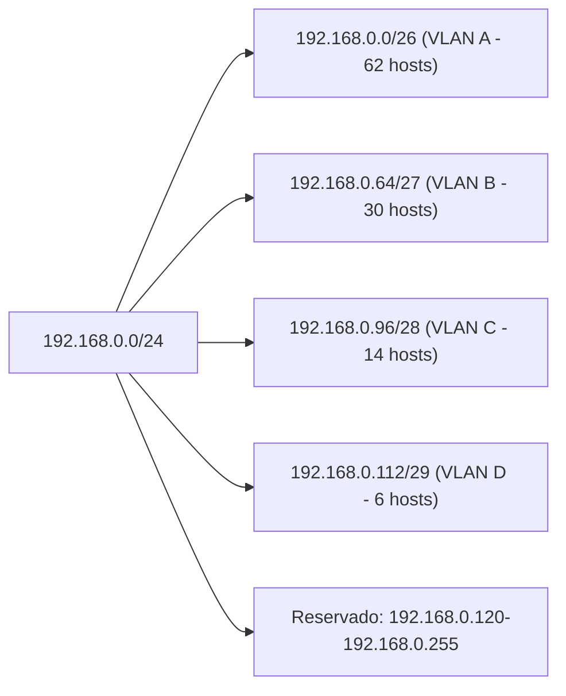

### 5.2 Direccionamiento lógico IPv6

*(CE-d: conocimiento y uso de direcciones IPv6 y sus tipos.)*

**IPv6** surge para solucionar el problema de escasez de direcciones IPv4 en Internet.

Una dirección lógica IPv6 consta de 128 bits, agrupados en 8 segmentos de 16 bits cada uno (8 hextetos), separados por dos puntos y representados en formato hexadecimal.

``` text
8888:9999:AAAA:BBBB:CCCC:DDDD:EEEE:FFFF(16)
```

#### 5.2.1 Reglas para reducir la notación de direcciones IPv6:
- Se puede omitir cualquier 0 a la izquierda de un hexteto.
    - 01AB -> 1AB
    - 0B00 -> B00
    - 0003 -> 3
- Se pueden omitir segmentos compuestos por solo ceros UNA VEZ y remplazar por ::
    - 2001:0DB7:0000:0000:1111:0000:0000:0200
    -> 2001:DB7:0:0:1111:0:0:200
	-> 2001:DB7::1111:0:0:200   o bien 2001:DB7:0:0:1111::200

**Ejemplo de transformación de direcciones IPv6 a notación abreviada**

```text
FE80:0000:0000:0000:0123:0123:ABCD:EFFF
	FE80::123:123:ABCD:EFFF
FFF1:0000:0000:0000:0000:0000:0000:0001
	FFF1::1
FF02:0000:0000:0000:FF00:0000:0000:0202
	FF02::FF00:0:0:202
0000:0000:0000:0000:0000:0000:0000:0001
	::1
0000:0000:0000:0000:0000:0000:0000:0000
	::
```

#### 5.2.2 Reglas para convertir una dirección IPv4 a IPv6

- La IPv6 empieza por 0000:0000:0000:0000:0000:FFFF -> ::FFFF
- Se transforma la IPv4 a hexadecimal y se divide en dos hextetos:

```text
    - 192.168.1.125
    - 1100 0000 . 1010 1000 . 0000 0001  . 0111 1101
    -    C 0         A 8    :    0 1     .    7 D
```
- Concatenamos la primera parte de la IPv6 con la IPv4 en hexadecimal:
```text
    - 0000:0000:0000:0000:0000:FFFF:C0A8:017D
```
- Transformamos la IPv6 a notación abreviada:
```text
    - ::FFFF:C0A8:17D
```

#### 5.2.3 Tipos de direccionamiento IPv6 según su forma de entrega : unicast, anycast y multicast

- **Unicast:** identifica a una interfaz de red de un único nodo. Cuando se envía un paquete a una dirección unicast, solo un nodo lo recibirá.
Ejemplos:
    - Global Unicast (2000::/3)
    - Unique Local Address (fc00::/7)
    - Link-Local (fe80::/10)
    - Loopback (::1)

- **Multicast:** identifica a un grupo de interfaces, generalmente de distintos nodos. Cuando se envía un paquete a una dirección multicast, todos los nodos del grupo lo recibirán.
Ejemplo:
    - ff00::/8

- **Anycast:** identifica a un grupo de interfaces, pero cuando se envía un paquete a una dirección anycast, solo el nodo más cercano al remitente lo recibirá.
Usos habituales:
    - Servidores DNS.
    - Balanceo de carga.
    - Servicios distribuidos.


#### 5.2.4 Direcciones reservadas y especiales IPv6

| Prefijo IPv6 | Nombre | Descripción | tipo |
|-------------|---------|-------------|------|
| ::/128 | Dirección no especificada | Indica ausencia de dirección. Se utiliza durante la autoconfiguración antes de obtener una dirección válida. | Especial |
| ::1/128 | Loopback | Permite que un equipo se comunique consigo mismo. Equivale a 127.0.0.1 en IPv4. |Unicast |
| fe80::/10 | Link-Local | Se configura automáticamente en las interfaces IPv6. Solo es válida dentro del enlace o red local y no se enruta. | Unicast |
| fc00::/7 | Unique Local Address (ULA) | Direcciones privadas para redes internas. Equivalen aproximadamente a las redes privadas de IPv4. | Unicast |
| 2000::/3 | Global Unicast | Direcciones públicas enrutables en Internet. | Unicast|
| ff00::/8 | Multicast | Direcciones utilizadas para enviar tráfico a grupos de dispositivos. Sustituyen al broadcast de IPv4. | Multicast |
| 2001:db8::/32 | Documentación | Reservadas para ejemplos, documentación y material educativo. | Especial |


#### 5.2.5 Configuración automática en IPv6

- **SLAAC (Stateless Address Autoconfiguration):** Permite que un dispositivo genere automáticamente su dirección IPv6 a partir del prefijo anunciado por el router.
- **Router Advertisement (RA):** Mensajes enviados por los routers IPv6 para anunciar:
    - Prefijo de red.
    - Puerta de enlace predeterminada.
    - Información para la autoconfiguración. Como indicaciones sobre si debe usarse DHCPv6
- **DHCPv6:** Permite proporcionar de forma centralizada:
    - Direcciones IPv6.
    - Servidores DNS.
    - Otros parámetros de configuración.
- **SLAAC + DHCPv6:** Es habitual utilizar ambos mecanismos:
    - SLAAC para obtener la dirección IPv6.
    - DHCPv6 para obtener información adicional, como los servidores DNS.

*¿Cómo funciona SLAAC?*
1. El equipo se conecta a la red.
2. Descubre que hay un router IPv6.
3. El router envía un Router Advertisement (RA). 
4. En ese RA anuncia un prefijo, por ejemplo:
	```text
	2001:db8:1:100::/64
	```
5. El equipo genera automáticamente el resto de la dirección siendo el resultado:
   ```text
   2001:db8:1:100:abcd:1234:5678:9abc
   ```
   Sin que nadie la haya configurado manualmente

#### 5.2.7 Comandos útiles
- Comprobaciones: `ip -6 addr`, `ip -6 route`, `ping6`/`ping -6`.

---


## 6. Direccionamiento dinámico: DHCP, DHCPv6 y SLAAC

*(CE-d: uso de sistemas de direccionamiento dinámico.)*

### 6.1 Métodos de asignación de direcciones IP mediante DHCP

- **Asignación manual o estática (Reserva):** el administrador asocia una dirección IP concreta a un cliente determinado, normalmente mediante su dirección MAC.
  Características:
    - Siempre recibe la misma dirección IP.
    - Permite controlar qué equipos obtienen dirección.
    - Habitual en servidores, impresoras y dispositivos de red.

- **Asignación automática:** el servidor DHCP asigna una dirección IP permanente al cliente la primera vez que la solicita.
  Características:
    - La dirección queda reservada para ese cliente.
    - No suele reutilizarse para otros equipos.
    - Actualmente es poco utilizada.

- **Asignación dinámica:** el servidor DHCP asigna una dirección IP durante un tiempo determinado (lease o concesión).
  Características:
    - Las direcciones IP pueden reutilizarse.
    - Es el método más utilizado actualmente.
    - Permite gestionar eficientemente grandes cantidades de dispositivos.

- **APIPA (Automatic Private IP Addressing):** si un cliente configurado para obtener una dirección mediante DHCP no encuentra ningún servidor DHCP disponible, Windows puede asignarse automáticamente una dirección del rango:
	```text
	169.254.0.1 - 169.254.255.254
	Máscara:
	255.255.0.0 (/16)
	```
  Características:
    - Permite la comunicación local entre equipos de la misma red.
    - No proporciona acceso a otras redes ni a Internet.
    - Indica habitualmente un problema con el servidor DHCP o la conectividad de red.

### 6.2 Opciones de configuración que puede proporcionar un servidor DHCP

- ✅ **Máscara de subred**
    - Muy utilizada actualmente.
    - Define qué parte de la dirección IP identifica la red y qué parte identifica el host.

- ✅ **Puerta de enlace predeterminada (Default Gateway)**
    - Muy utilizada actualmente.
    - Permite la comunicación con otras redes e Internet.

- ✅ **Dirección de los servidores DNS**
    - Muy utilizada actualmente.
    - Permite resolver nombres de dominio a direcciones IP.

- ✅ **Nombre de dominio DNS**
    - Muy utilizado actualmente.
    - Permite completar automáticamente nombres de host dentro de una organización.

- ✅ **MTU (Maximum Transmission Unit)**
    - Sigue existiendo y puede configurarse mediante DHCP.
    - Se utiliza en entornos específicos donde es necesario ajustar el tamaño máximo de los paquetes.

- ✅ **MTU (Maximum Transmission Unit)**
    - Sigue existiendo y puede configurarse mediante DHCP.
    - Se utiliza en entornos específicos donde es necesario ajustar el tamaño máximo de los paquetes.

- ✅ **Servidores NTP (Network Time Protocol)**
    - Muy utilizados actualmente.
    - Permiten sincronizar la hora de equipos y servidores.

- ✅ **Servidor TFTP**
    - Sigue utilizándose en determinados entornos.
    - Muy común en arranque por red (PXE), teléfonos IP, routers y switches.

- ⚠️ **Dirección de Broadcast**
    - Poco utilizada actualmente como opción DHCP.
    - Los sistemas operativos suelen calcularla automáticamente a partir de la IP y la máscara.

- ⚠️ **Tiempo máximo de espera de ARP**
    - Poco habitual en redes modernas.
    - Normalmente se configura en el sistema operativo o en los dispositivos de red.

- ❌ **Servidores NIS (Network Information Service)**
    - Tecnología antigua de sistemas Unix.
    - Prácticamente en desuso.

- ❌ **Dominios NIS**
    - Asociados al servicio NIS.
    - Prácticamente en desuso.

- ❌ **Servidor SMTP**
    - Muy poco habitual como opción DHCP.
    - Las aplicaciones de correo suelen configurarlo directamente.

- ❌ **Servidor WINS (Windows Internet Name Service)**
    - Tecnología heredada de Microsoft basada en NetBIOS.
    - Prácticamente sustituida por DNS.


### 6.3 Funcionamiento de DHCP (DORA)

- **DISCOVER:** el cliente broadcast solicita configuración.
- **OFFER:** el servidor ofrece una dirección y parámetros.
- **REQUEST:** el cliente solicita formalmente la oferta elegida.
- **ACK:** el servidor confirma y asigna la configuración.

#### 6.3.1 Diagrama: proceso DORA (DHCP)

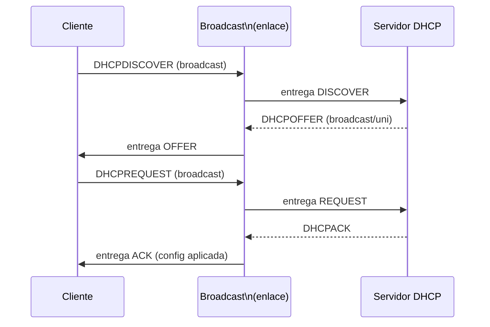

### 6.4 DHCPv6 y SLAAC

- **DHCPv6:** similar a DHCPv4, pero con diferencias en transporte y opciones. Puede funcionar en modo **stateless** (sin asignar direcciones; proporciona solo opciones adicionales, como DNS) o **stateful** (asigna direcciones IPv6 y proporciona opciones).
- **SLAAC (Stateless Address Autoconfiguration):** el host genera su propia dirección a partir del prefijo anunciado por el router (RA). Puede combinarse con DHCPv6 para opciones adicionales.

---

## 7. Adaptadores de red: instalación y configuración (alámbricos e inalámbricos)

*(CE-e: configuración de adaptadores de red en distintos sistemas operativos.)*

Los **adaptadores de red** son elementos que se encargan de unir los ordenadores a la propia red, es decir, conectan el ordenador al medio físico de transmisión, permitiendo transformar la información interna del ordenador que se desea transmitir, en una señal compatible capaz de ser enviada a través del medio de transmisión. También se llaman tarjetas de red, interfaces de red, o NIC.

Los adaptadores pueden estar incluidos en el hardware del equipo, es decir, internos, o ser externos con conexión USB principalmente.

Los adaptadores se distinguen por el *tipo de conexión* a la placa base y por el tipo de conexión al medio de transmisión.
**Tipo de conexión del adaptador:** indica cómo se conecta físicamente el adaptador al equipo —por ejemplo, integrado, PCIe, USB o M.2— y al medio de transmisión —por ejemplo, cable Ethernet o señal Wi‑Fi—.

### 7.1 Tipos de adaptadores y controladores

- **Integrados (onboard):** tarjeta PCIe, USB‑Ethernet y adaptadores Wi‑Fi (PCIe/USB/M.2).
- **Driver/controlador:** programa que permite al sistema operativo comunicarse con el adaptador.
- **Firmware:** software interno del propio adaptador que controla algunas de sus funciones. Muy importante que sean versiones compatibles y firmwares actualizados.

Por ejemplo, un adaptador USB‑Ethernet se conecta al ordenador por USB y a la red mediante un cable Ethernet. El driver permite que el sistema operativo lo use; no es el cable ni la conexión al medio.

### 7.2 Adaptadores alámbricos

Este tipo de adaptadores son los utilizados para conectar los equipos a las redes de cable, a través de conectores BNC (en desuso), RJ45 o de fibra óptica. Hay varios tipos:
- Tarjeta interna PCI
- Tarjeta interna PCI- express
- Adaptador USB. Alternativa a las tarjetas internas, más fácil de instalar 

**Ejemplos:**

 Es un adaptador USB‑Ethernet externo: se conecta al ordenador por USB‑A y ofrece un puerto RJ‑45 para conectar un cable Ethernet a la red.

 Esta es una tarjeta de red Ethernet interna PCIe. Se instala en una ranura de expansión de la placa base y proporciona un puerto RJ‑45 para conectar el cable de red

#### 7.2.1 Instalación alámbrica

Al instalar una tarjeta de red, el sistema operativo debe disponer del driver adecuado para reconocerla y utilizarla. Normalmente lo instala automáticamente; si no, se instala manualmente.
Una vez reconocido el adaptador, la configuración de red puede obtenerse automáticamente mediante DHCP o introducirse manualmente. Los parámetros habituales son:

- Dirección IP
- Máscara de red o prefijo
- Puerta de enlace predeterminada
- Servidor o servidores DNS
La puerta de enlace y el DNS suelen ser necesarios para comunicarse con otras redes y resolver nombres de dominio, respectivamente; en una configuración estática se indican según los requisitos de la red.

### 7.3 Adaptadores inalámbricos

Los **adaptadores inalámbricos** se utilizan para el mismo fin que los alámbricos, pero sin necesidad de conectar ningún tipo de cable. Son más cómodos de instalar y más sencillos de configurar.

Tipos de adaptador (por conexión al equipo):
- Tarjeta PCMCIA. Prácticamente en desuso.
- Tarjeta interna PCI‑Express.
- Adaptador USB. Versión para el acceso inalámbrico a través de USB.

**Ejemplos:**

 tarjeta de red inalámbrica Wi‑Fi para ranura CardBus/PC Card (PCMCIA), un formato de expansión que se utilizaba en portátiles antiguos. Se insertaba en la ranura lateral del portátil para añadir conectividad Wi‑Fi; el pequeño elemento que sobresale forma parte de la tarjeta y contiene la antena.

 tarjeta de red inalámbrica Wi‑Fi interna PCIe para un ordenador de sobremesa. Se instala en una ranura PCIe de la placa base y sus antenas permiten conectarse a la red por Wi‑Fi.


#### 7.3.1 Instalación inalámbrica en la WLAN

Al instalar una tarjeta de red, el sistema operativo debe disponer del driver adecuado para reconocerla y utilizarla. Normalmente lo instala automáticamente; si no, se instala manualmente.

Para **conectarse a una red Wi‑Fi** es necesario seleccionar el **SSID (nombre de la red)** y, si procede, proporcionar las credenciales de seguridad. Dependiendo del tipo de red esto puede implicar:

- **WPA2‑PSK / WPA3‑PSK:** clave compartida (contraseña) que se introduce en el cliente.
- **WPA2/WPA3 Enterprise (802.1X):** autenticación por usuario/contraseña (EAP‑PEAP, EAP‑TTLS) o mediante certificados (EAP‑TLS). Requiere un servidor RADIUS en la red.

A continuación se incluye una tabla comparativa de los métodos de acceso más habituales y un diagrama simple del flujo RADIUS.

**Comparativa: métodos de autenticación y acceso en WLAN**

| Método | Caso de uso | Nivel de seguridad | Ventajas | Inconvenientes |
|--------|-------------|--------------------|---------|----------------|
| Open (sin seguridad) | SSID público/IoT aislado (red de invitados con portal) | ⚪ Muy bajo | Fácil acceso; sin configuración | Sin cifrado ni autenticación; inseguro |
| Captive Portal (Web) | Redes de invitados en campus y hoteles | ⚪ Bajo/Medio | Control de acceso sencillo, integración con vouchers | Cifrado normalmente solo a nivel de HTTPS; no autentica al enlace 802.1X |
| WPA2‑PSK / WPA3‑PSK | Redes domésticas / pequeñas oficinas | 🟡 Medio (WPA2) / 🟡→🟠 mejor (WPA3) | Fácil configuración (clave) | Gestión de contraseñas difícil en grandes entornos; PSK compartida por todos |
| WPA2/WPA3‑Enterprise (802.1X + RADIUS) | Entornos educativos, empresas | 🟠/🔴 Alto (con EAP‑TLS) | Autenticación por usuario/certificado, control centralizado | Requiere infraestructura RADIUS/PKI y mayor complejidad |

- *Recomendación general:* evitar WEP y TKIP; preferir AES/CCMP y WPA3 si el hardware lo permite. En entornos con muchos usuarios y control de acceso se recomienda WPA‑Enterprise con EAP‑TLS para máxima seguridad.

**Diagrama: flujo básico RADIUS (Autenticación 802.1X)**

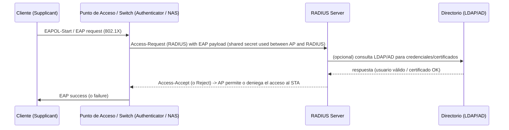

> Notas:
- El AP (o switch) actúa como "authenticator" y no conoce las credenciales: las reenvía al servidor RADIUS.
- El secreto compartido RADIUS (shared secret) se usa entre AP y RADIUS para proteger mensajes (no sustituye a EAP/TLS en la autenticación cliente‑servidor).
- EAP‑TLS usa certificados mutuos y proporciona el mayor nivel de confianza.

*Parámetros y conceptos relevantes:*

- `SSID:` nombre de la red. Puede haber SSID para invitados y SSID para administración (separación de tráfico).
- `Banda y canal:` 2.4 GHz (mayor cobertura y congestión) frente a 5 GHz/6 GHz (mayor capacidad y menor alcance). Elegir canal evita interferencias.
- `Modos 802.11: b/g/n/ac/ax` — indicar la compatibilidad de adaptador y AP; preferir los modos más modernos cuando el hardware lo soporta.
- `Seguridad:` evitar WEP y TKIP; preferir AES (CCMP) y WPA3 si es posible.
- `Potencia/antena y RSSI:` la calidad del enlace depende de la potencia y la antena; medir RSSI o SNR para evaluar cobertura.

*Configuración IP y servicios asociados:*

- Normalmente `la dirección IP, puerta de enlace y DNS` se obtienen por DHCP. En servidores o pruebas puede requerirse IP estática.
- `DNS y puerta de enlace` son necesarios para acceso a Internet y resolución de nombres.

*Autenticación avanzada y certificados:*

- `802.1X con RADIUS:` usado en entornos educativos y empresariales; permite autenticación por usuario o por certificados. `RADIUS (Remote Authentication Dial-In User Service)` es un protocolo de red usado para autenticar, autorizar y contabilizar (AAA) el acceso de usuarios y dispositivos a redes y servicios.
- `EAP‑TLS:` método robusto basado en certificados (recomendado para alta seguridad).


### 7.4  parámetros avanzados del adaptador

Normalmente se dejan con los valores predeterminados.
- **Velocidad y dúplex:** indican la velocidad del enlace y si puede transmitir y recibir simultáneamente. 1000Full significa 1 Gbit/s en modo full-duplex; 100Half, 100 Mbit/s en half-duplex. En general se deja autonegociación para que el adaptador y el switch acuerden la mejor configuración.
- **MTU:** tamaño máximo de la unidad de datos que se transmite por la red. En Ethernet suele ser 1500 bytes. Los jumbo frames permiten tamaños mayores, pero solo funcionan correctamente si todos los equipos y enlaces del trayecto los admiten y están configurados igual.
- **Wake-on-LAN (WoL):** permite encender o reactivar un equipo a través de la red, normalmente mediante un paquete mágico. Requiere compatibilidad del adaptador, la placa base y la configuración de energía.
- **Offloads (TSO, LRO):** funciones que delegan en la tarjeta de red parte del trabajo de procesar los paquetes, reduciendo carga de la CPU. TSO ayuda con la transmisión; LRO agrupa datos recibidos. Normalmente se dejan activadas según el driver.
- **VLAN tagging:** permite que el adaptador añada a las tramas una etiqueta 802.1Q para identificar a qué VLAN pertenecen. Se usa en redes configuradas para VLAN y debe coincidir con la configuración del switch.

### 7.5 Comandos y verificaciones por SO

- Escaneo y estado: `iw dev`, `iwlist scan`, `nmcli device wifi list`.
- Estadísticas y enlace: `iwconfig`, `iw dev wlan0 link`, `iw wlan0 link` o `nmcli -f ALL device show wlan0`.
- Señal y ruido: RSSI y SNR (probar en diferentes ubicaciones para medir cobertura).
- Conectividad: `ping`, `traceroute` / `tracepath`.
- Windows: `ipconfig /all`, `netsh interface show interface`, Device Manager para drivers.
- Linux: `ip link show`, `ip addr`, `ethtool <iface>` para velocidad/duplex/ethtool options.


**Ejemplos de salida representativos**

Ejemplo simplificado de `iw dev` (interfaz y capacidades):

```text
$ iw dev
phy#0
	Interface wlan0
		type managed
		wdev 0x1
		addr 12:34:56:78:9a:bc
		ssid MiSSID
		channel 36 (5180 MHz), width: 80 MHz, center1: 5210 MHz
```

Ejemplo simplificado de `nmcli device wifi list` (escaneo de SSID):

```text
$ nmcli device wifi list
IN-USE  SSID             MODE   CHAN  RATE       SIGNAL  BARS  SECURITY
        MiSSID           Infra  36    130 Mbit/s 78      ▂▄▆_  WPA2
        Visitantes        Infra  6     54 Mbit/s  52      ▂▄__  WPA2
        LibreOpen        Infra  11    54 Mbit/s  30      ▂___  --
```

Ejemplo de `radtest` y respuesta RADIUS (radtest against FreeRADIUS local server):

```text
$ radtest usuario password localhost 0 testing123
Sending Access-Request of id 182 to 127.0.0.1 port 1812
	User-Name = "usuario"
	User-Password = "password"

Received Access-Accept Id 182 from 127.0.0.1:1812

# Interpretación: el servidor RADIUS ha aceptado las credenciales y permite el acceso.
```

(Estas salidas son ejemplos representativos: los encabezados/atributos y detalles reales dependen de la versión de las herramientas y de la configuración del sistema.)

---

## 8. Monitorización de la red mediante SNMP

*(CE-i: monitorización de la red mediante aplicaciones basadas en SNMP.)*
La **monitorización** de una red es el análisis del estado de los recursos. Para analizar los recursos de una red debemos estructurar nuestro estudio en partes diferenciadas.
- Establecer que parámetros queremos monitorizar.
- Conocer los métodos para acceder a los parámetros monitorizados.
- Gestionar la información recopilada de los parámetros monitorizados.

La monitorización puede ser parcial o total, continua u ocasional y se puede llevar a cabo de manera local o remota. Además, aunque puede ser diferida, la monitorización es conveniente que sea en `tiempo real`.

**SNMP (Protocolo simple de administración de red)** es un protocolo de capa de aplicación utilizado para obtener información y gestionar dispositivos de red. La monitorización suele emplear dos mecanismos:

- **Sondeo (polling):** el gestor consulta a los agentes SNMP para obtener datos, periódicamente o bajo demanda. El agente responde a cada consulta.
- **Notificaciones:** el agente informa al gestor cuando ocurre un evento. Las notificaciones `Trap` se envían de forma asíncrona y normalmente no requieren confirmación; las `Inform` sí solicitan confirmación.

**SNMP** suele utilizar `UDP`, un protocolo de transporte no orientado a conexión. Cada dispositivo gestionado ejecuta un agente SNMP, que responde a las consultas del gestor y puede enviarle notificaciones cuando ocurren determinados eventos. 

La información accesible se organiza mediante una `MIB (Management Information Base)`, que describe los objetos gestionables y sus identificadores; no es, por sí misma, una base de datos central de mediciones. El gestor puede almacenar los datos recopilados en su propia base de datos.

La monitorización con SNMP puede realizarse desde la línea de comandos, mediante herramientas específicas, o utilizando aplicaciones con interfaz gráfica.

Una herramienta de software libre utilizada para monitorizar redes mediante SNMP es **Zabbix**. Permite consultar métricas de los dispositivos, visualizar gráficas y configurar alertas. También existen alternativas como **Nagios** y **LibreNMS**.

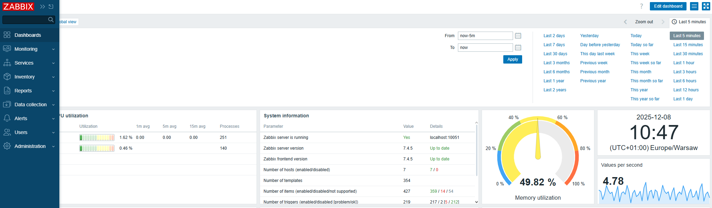

---
